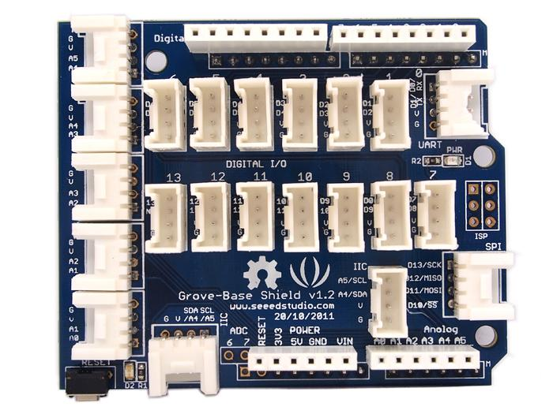

.. image:: /images/seeed_grove.png
   :align: right

.. _grove_base_shield_v12:

Grove Base Shield V1.2
######################

Overview
********

**Model:** SLD12148P

The initial `Grove Base Shield V1.2`_ board is very similar in fashion to an
Arduino shield board. Here is a top view:

Power Compatible
================

Every Grove connector has four wires, one of which is the VCC that is hard
wired to 5V. Every controller main board needs a supply voltage of 5V and
only 5V compatible Grove modules are possible.

Pinout Diagram
==============

The pinout of Base Shield V1.3 is the same as `Arduino Uno R2`_. The shield
usually has the same pin position as the Arduino development board and can
be stacked and plugged into Arduino compatible boatds to implement specific
functions.

Hardware
========

- `Grove Base Shield V1.2 Eagle Files`_

+-------+---------------------------------+----+----+----+----+----+-----+---------+----+----+----+----+----+----+----+----+----+-----+-----+-----+-----+-----+
| Name  | Function to Grove port-pin -->  | A0 | A1 | A2 | A3 | A4 | IIC | UART/D0 | D1 | D2 | D3 | D4 | D5 | D6 | D7 | D8 | D9 | D10 | D11 | D12 | D13 | SPI |
+=======+=================================+====+====+====+====+====+=====+=========+====+====+====+====+====+====+====+====+====+=====+=====+=====+=====+=====+
| A0    | Analog 0 / Digital 14           |  1 |    |    |    |    |     |         |    |    |    |    |    |    |    |    |    |     |     |     |     |     |
+-------+---------------------------------+----+----+----+----+----+-----+---------+----+----+----+----+----+----+----+----+----+-----+-----+-----+-----+-----+
| A1    | Analog 1 / Digital 15           |  2 |  1 |    |    |    |     |         |    |    |    |    |    |    |    |    |    |     |     |     |     |     |
+-------+---------------------------------+----+----+----+----+----+-----+---------+----+----+----+----+----+----+----+----+----+-----+-----+-----+-----+-----+
| A2    | Analog 2 / Digital 16           |    |  2 |  1 |    |    |     |         |    |    |    |    |    |    |    |    |    |     |     |     |     |     |
+-------+---------------------------------+----+----+----+----+----+-----+---------+----+----+----+----+----+----+----+----+----+-----+-----+-----+-----+-----+
| A3    | Analog 3 / Digital 17           |    |    |  2 |  1 |    |     |         |    |    |    |    |    |    |    |    |    |     |     |     |     |     |
+-------+---------------------------------+----+----+----+----+----+-----+---------+----+----+----+----+----+----+----+----+----+-----+-----+-----+-----+-----+
| A4    | Analog 4 / Digital 18 / I2C-SDA |    |    |    |  2 |  1 |  2  |         |    |    |    |    |    |    |    |    |    |     |     |     |     |     |
+-------+---------------------------------+----+----+----+----+----+-----+---------+----+----+----+----+----+----+----+----+----+-----+-----+-----+-----+-----+
| A5    | Analog 5 / Digital 19 / I2C-SCL |    |    |    |    |  2 |  1  |         |    |    |    |    |    |    |    |    |    |     |     |     |     |     |
+-------+---------------------------------+----+----+----+----+----+-----+---------+----+----+----+----+----+----+----+----+----+-----+-----+-----+-----+-----+
| D0    | Digital 0 / UART-RX             |    |    |    |    |    |     |    1    |    |    |    |    |    |    |    |    |    |     |     |     |     |     |
+-------+---------------------------------+----+----+----+----+----+-----+---------+----+----+----+----+----+----+----+----+----+-----+-----+-----+-----+-----+
| D1    | Digital 1 / UART-TX             |    |    |    |    |    |     |    2    |  1 |    |    |    |    |    |    |    |    |     |     |     |     |     |
+-------+---------------------------------+----+----+----+----+----+-----+---------+----+----+----+----+----+----+----+----+----+-----+-----+-----+-----+-----+
| D2    | Digital 2 (INT0)                |    |    |    |    |    |     |         |  2 |  1 |    |    |    |    |    |    |    |     |     |     |     |     |
+-------+---------------------------------+----+----+----+----+----+-----+---------+----+----+----+----+----+----+----+----+----+-----+-----+-----+-----+-----+
| D3    | Digital 3 (INT1)                |    |    |    |    |    |     |         |    |  2 |  1 |    |    |    |    |    |    |     |     |     |     |     |
+-------+---------------------------------+----+----+----+----+----+-----+---------+----+----+----+----+----+----+----+----+----+-----+-----+-----+-----+-----+
| D4    | Digital 4                       |    |    |    |    |    |     |         |    |    |  2 |  1 |    |    |    |    |    |     |     |     |     |     |
+-------+---------------------------------+----+----+----+----+----+-----+---------+----+----+----+----+----+----+----+----+----+-----+-----+-----+-----+-----+
| D5    | Digital 5                       |    |    |    |    |    |     |         |    |    |    |  2 |  1 |    |    |    |    |     |     |     |     |     |
+-------+---------------------------------+----+----+----+----+----+-----+---------+----+----+----+----+----+----+----+----+----+-----+-----+-----+-----+-----+
| D6    | Digital 6                       |    |    |    |    |    |     |         |    |    |    |    |  2 |  1 |    |    |    |     |     |     |     |     |
+-------+---------------------------------+----+----+----+----+----+-----+---------+----+----+----+----+----+----+----+----+----+-----+-----+-----+-----+-----+
| D7    | Digital 7                       |    |    |    |    |    |     |         |    |    |    |    |    |  2 |  1 |    |    |     |     |     |     |     |
+-------+---------------------------------+----+----+----+----+----+-----+---------+----+----+----+----+----+----+----+----+----+-----+-----+-----+-----+-----+
| D8    | Digital 8                       |    |    |    |    |    |     |         |    |    |    |    |    |    |  2 |  1 |    |     |     |     |     |     |
+-------+---------------------------------+----+----+----+----+----+-----+---------+----+----+----+----+----+----+----+----+----+-----+-----+-----+-----+-----+
| D9    | Digital 9                       |    |    |    |    |    |     |         |    |    |    |    |    |    |    |  2 |  1 |     |     |     |     |     |
+-------+---------------------------------+----+----+----+----+----+-----+---------+----+----+----+----+----+----+----+----+----+-----+-----+-----+-----+-----+
| D10   | Digital 10 / SPI-CS             |    |    |    |    |    |     |         |    |    |    |    |    |    |    |    |  2 |  1  |     |     |     |  4  |
+-------+---------------------------------+----+----+----+----+----+-----+---------+----+----+----+----+----+----+----+----+----+-----+-----+-----+-----+-----+
| D11   | Digital 11 / SPI-MOSI           |    |    |    |    |    |     |         |    |    |    |    |    |    |    |    |    |  2  |  1  |     |     |  3  |
+-------+---------------------------------+----+----+----+----+----+-----+---------+----+----+----+----+----+----+----+----+----+-----+-----+-----+-----+-----+
| D12   | Digital 12 / SPI-MISO           |    |    |    |    |    |     |         |    |    |    |    |    |    |    |    |    |     |  2  |  1  |     |  2  |
+-------+---------------------------------+----+----+----+----+----+-----+---------+----+----+----+----+----+----+----+----+----+-----+-----+-----+-----+-----+
| D13   | Digital 13 / SPI-CLK            |    |    |    |    |    |     |         |    |    |    |    |    |    |    |    |    |     |     |  2  |  1  |  1  |
+-------+---------------------------------+----+----+----+----+----+-----+---------+----+----+----+----+----+----+----+----+----+-----+-----+-----+-----+-----+

References
**********

.. target-notes::
