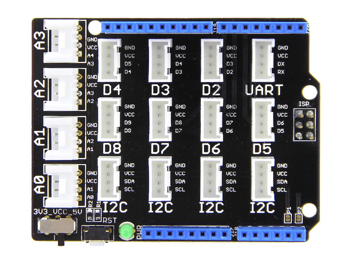

.. image:: /images/seeed_grove.png
   :align: right

.. _grove_base_shield_v2:

Grove Base Shield V2
####################

Overview
********

**Model:** 103030000

The `Grove Base Shield V2.1`_ and `Grove Base Shield V2.0`_ board provides
a simple way to connect with Arduino boards. This version 2 focuses on the
simplicity of power supply.

Power Compatible
================

Every Grove connector has four wires, one of which is the VCC. However, not
every controller main board needs a supply voltage of 5V, some boards only
need 3.3V. That's why now a power toggle switch was add to this version so
that one can select the suitable voltage of the controller main board using
via this switch.

Pinout Diagram
==============

The pinout of Base Shield V2 is the same as `Arduino Uno R3`_. The shield
usually has the same pin position as the Arduino development board and can
be stacked and plugged into Arduino compatible boatds to implement specific
functions.

Hardware
========

- `Grove Base Shield V2.1 Eagle Schematic`_
- `Grove Base Shield V2.1 Eagle Layout`_
- `Grove Base Shield V2.1 Schematic`_
- `Grove Base Shield V2.1 Layout`_
- `Grove Base Shield V2.0 Eagle Files`_
- `Grove Base Shield V2.0 Schematic`_

+-------+---------------------------------+----+----+----+----+-------+------+----+----+----+----+----+----+----+
| Name  | Function to Grove port-pin -->  | A0 | A1 | A2 | A3 |  I2C  | UART | D2 | D3 | D4 | D5 | D6 | D7 | D8 |
+=======+=================================+====+====+====+====+=======+======+====+====+====+====+====+====+====+
| A0    | Analog 0 / Digital 14           |  1 |    |    |    |       |      |    |    |    |    |    |    |    |
+-------+---------------------------------+----+----+----+----+-------+------+----+----+----+----+----+----+----+
| A1    | Analog 1 / Digital 15           |  2 |  1 |    |    |       |      |    |    |    |    |    |    |    |
+-------+---------------------------------+----+----+----+----+-------+------+----+----+----+----+----+----+----+
| A2    | Analog 2 / Digital 16           |    |  2 |  1 |    |       |      |    |    |    |    |    |    |    |
+-------+---------------------------------+----+----+----+----+-------+------+----+----+----+----+----+----+----+
| A3    | Analog 3 / Digital 17           |    |    |  2 |  1 |       |      |    |    |    |    |    |    |    |
+-------+---------------------------------+----+----+----+----+-------+------+----+----+----+----+----+----+----+
| A4    | Analog 4 / Digital 18 / I2C-SDA |    |    |    |  2 | 2 (*) |      |    |    |    |    |    |    |    |
+-------+---------------------------------+----+----+----+----+-------+------+----+----+----+----+----+----+----+
| A5    | Analog 5 / Digital 19 / I2C-SCL |    |    |    |    | 1 (*) |      |    |    |    |    |    |    |    |
+-------+---------------------------------+----+----+----+----+-------+------+----+----+----+----+----+----+----+
| D0    | Digital 0 / UART-RX             |    |    |    |    |       |   1  |    |    |    |    |    |    |    |
+-------+---------------------------------+----+----+----+----+-------+------+----+----+----+----+----+----+----+
| D1    | Digital 1 / UART-TX             |    |    |    |    |       |   2  |    |    |    |    |    |    |    |
+-------+---------------------------------+----+----+----+----+-------+------+----+----+----+----+----+----+----+
| D2    | Digital 2 (INT0)                |    |    |    |    |       |      |  1 |    |    |    |    |    |    |
+-------+---------------------------------+----+----+----+----+-------+------+----+----+----+----+----+----+----+
| D3    | Digital 3 (INT1)                |    |    |    |    |       |      |  2 |  1 |    |    |    |    |    |
+-------+---------------------------------+----+----+----+----+-------+------+----+----+----+----+----+----+----+
| D4    | Digital 4                       |    |    |    |    |       |      |    |  2 |  1 |    |    |    |    |
+-------+---------------------------------+----+----+----+----+-------+------+----+----+----+----+----+----+----+
| D5    | Digital 5                       |    |    |    |    |       |      |    |    |  2 |  1 |    |    |    |
+-------+---------------------------------+----+----+----+----+-------+------+----+----+----+----+----+----+----+
| D6    | Digital 6                       |    |    |    |    |       |      |    |    |    |  2 |  1 |    |    |
+-------+---------------------------------+----+----+----+----+-------+------+----+----+----+----+----+----+----+
| D7    | Digital 7                       |    |    |    |    |       |      |    |    |    |    |  2 |  1 |    |
+-------+---------------------------------+----+----+----+----+-------+------+----+----+----+----+----+----+----+
| D8    | Digital 8                       |    |    |    |    |       |      |    |    |    |    |    |  2 |  1 |
+-------+---------------------------------+----+----+----+----+-------+------+----+----+----+----+----+----+----+
| D9    | Digital 9                       |    |    |    |    |       |      |    |    |    |    |    |    |  2 |
+-------+---------------------------------+----+----+----+----+-------+------+----+----+----+----+----+----+----+
| D10   | Digital 10 / SPI-CS             |    |    |    |    |       |      |    |    |    |    |    |    |    |
+-------+---------------------------------+----+----+----+----+-------+------+----+----+----+----+----+----+----+
| D11   | Digital 11 / SPI-MOSI           |    |    |    |    |       |      |    |    |    |    |    |    |    |
+-------+---------------------------------+----+----+----+----+-------+------+----+----+----+----+----+----+----+
| D12   | Digital 12 / SPI-MISO           |    |    |    |    |       |      |    |    |    |    |    |    |    |
+-------+---------------------------------+----+----+----+----+-------+------+----+----+----+----+----+----+----+
| D13   | Digital 13 / SPI-CLK            |    |    |    |    |       |      |    |    |    |    |    |    |    |
+-------+---------------------------------+----+----+----+----+-------+------+----+----+----+----+----+----+----+
| D18   | Digital 18 / I2C-SDA            |    |    |    |    |   2   |      |    |    |    |    |    |    |    |
+-------+---------------------------------+----+----+----+----+-------+------+----+----+----+----+----+----+----+
| D19   | Digital 19 / I2C-SCL            |    |    |    |    |   1   |      |    |    |    |    |    |    |    |
+-------+---------------------------------+----+----+----+----+-------+------+----+----+----+----+----+----+----+

(*) I2C bus default disconnected by open solder pads.

References
**********

.. target-notes::
