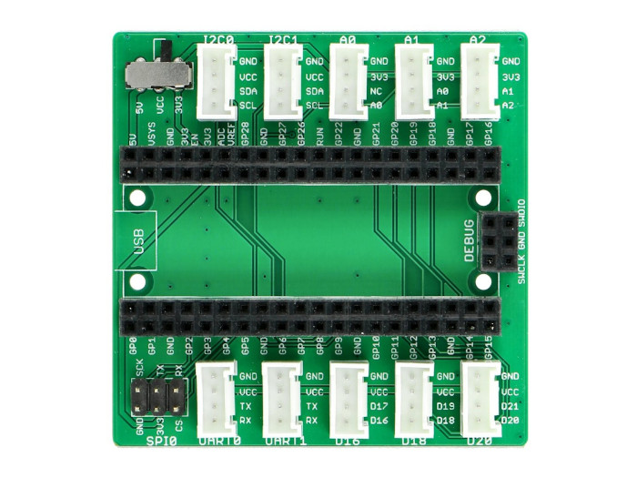

.. image:: /images/seeed_grove.png
   :align: right

.. _grove_rpipico_shield_v1:

Grove Shield for Pi Pico V1
###########################

Overview
********

**Model:** 103100142

The `Grove Shield for Pi Pico V1`_ board provides a simple way to connect
with Raspberry Pi Pico boards. This version 1 is the first member in the
Grove System to support low-cost, high-performance microcontroller RP2040
on the Raspberry Pi Pico boards, either with or without W option.

Power Compatible
================

Every Grove connector has four wires, one of which is the VCC. However, not
every controller main board needs a supply voltage of 5V, some boards only
need 3.3V. That's why now a power toggle switch was add to this version so
that one can select the suitable voltage of the controller main board using
via this switch.

Pinout Diagram
==============

The pinout of Shield for Pi Pico V1 is the same as `Raspberry Pi Pico R3`_ or
`Raspberry Pi Pico R3 W`_. The shield usually has the same pin position as the
Raspberry Pi Pico development board and will be used as an carrier board.

Hardware
========

- `Grove Shield for Pi Pico V1.0 Schematic`_
- `Grove Shield for Pi Pico V1.0 Eagle Files`_

+-------+---------------------------------+-------+-------+------+------+-----+-----+-----+----+----+----+
| Name  | Function to Grove port-pin -->  | UART0 | UART1 | I2C0 | I2C1 | D16 | D18 | D20 | A0 | A1 | A2 |
+=======+=================================+=======+=======+======+======+=====+=====+=====+====+====+====+
| GP0   | Digital 0                       |   2   |       |      |      |     |     |     |    |    |    |
+-------+---------------------------------+-------+-------+------+------+-----+-----+-----+----+----+----+
| GP1   | Digital 1                       |   1   |       |      |      |     |     |     |    |    |    |
+-------+---------------------------------+-------+-------+------+------+-----+-----+-----+----+----+----+
| GP2   | Digital 2                       |       |       |      |      |     |     |     |    |    |    |
+-------+---------------------------------+-------+-------+------+------+-----+-----+-----+----+----+----+
| GP3   | Digital 3                       |       |       |      |      |     |     |     |    |    |    |
+-------+---------------------------------+-------+-------+------+------+-----+-----+-----+----+----+----+
| GP4   | Digital 4                       |       |   2   |      |      |     |     |     |    |    |    |
+-------+---------------------------------+-------+-------+------+------+-----+-----+-----+----+----+----+
| GP5   | Digital 5                       |       |   1   |      |      |     |     |     |    |    |    |
+-------+---------------------------------+-------+-------+------+------+-----+-----+-----+----+----+----+
| GP6   | Digital 6                       |       |       |      |   2  |     |     |     |    |    |    |
+-------+---------------------------------+-------+-------+------+------+-----+-----+-----+----+----+----+
| GP7   | Digital 7                       |       |       |      |   1  |     |     |     |    |    |    |
+-------+---------------------------------+-------+-------+------+------+-----+-----+-----+----+----+----+
| GP8   | Digital 8                       |       |       |   2  |      |     |     |     |    |    |    |
+-------+---------------------------------+-------+-------+------+------+-----+-----+-----+----+----+----+
| GP9   | Digital 9                       |       |       |   1  |      |     |     |     |    |    |    |
+-------+---------------------------------+-------+-------+------+------+-----+-----+-----+----+----+----+
| GP10  | Digital 10                      |       |       |      |      |     |     |     |    |    |    |
+-------+---------------------------------+-------+-------+------+------+-----+-----+-----+----+----+----+
| GP11  | Digital 11                      |       |       |      |      |     |     |     |    |    |    |
+-------+---------------------------------+-------+-------+------+------+-----+-----+-----+----+----+----+
| GP12  | Digital 12                      |       |       |      |      |     |     |     |    |    |    |
+-------+---------------------------------+-------+-------+------+------+-----+-----+-----+----+----+----+
| GP13  | Digital 13                      |       |       |      |      |     |     |     |    |    |    |
+-------+---------------------------------+-------+-------+------+------+-----+-----+-----+----+----+----+
| GP14  | Digital 14                      |       |       |      |      |     |     |     |    |    |    |
+-------+---------------------------------+-------+-------+------+------+-----+-----+-----+----+----+----+
| GP15  | Digital 15                      |       |       |      |      |     |     |     |    |    |    |
+-------+---------------------------------+-------+-------+------+------+-----+-----+-----+----+----+----+
| GP16  | Digital 16                      |       |       |      |      |  1  |     |     |    |    |    |
+-------+---------------------------------+-------+-------+------+------+-----+-----+-----+----+----+----+
| GP17  | Digital 17                      |       |       |      |      |  2  |     |     |    |    |    |
+-------+---------------------------------+-------+-------+------+------+-----+-----+-----+----+----+----+
| GP18  | Digital 18                      |       |       |      |      |     |  1  |     |    |    |    |
+-------+---------------------------------+-------+-------+------+------+-----+-----+-----+----+----+----+
| GP19  | Digital 19                      |       |       |      |      |     |  2  |     |    |    |    |
+-------+---------------------------------+-------+-------+------+------+-----+-----+-----+----+----+----+
| GP20  | Digital 20                      |       |       |      |      |     |     |  1  |    |    |    |
+-------+---------------------------------+-------+-------+------+------+-----+-----+-----+----+----+----+
| GP21  | Digital 21                      |       |       |      |      |     |     |  2  |    |    |    |
+-------+---------------------------------+-------+-------+------+------+-----+-----+-----+----+----+----+
| GP22  | Digital 22                      |       |       |      |      |     |     |     |    |    |    |
+-------+---------------------------------+-------+-------+------+------+-----+-----+-----+----+----+----+
| GP23  | (Digital 23) not on header      |       |       |      |      |     |     |     |    |    |    |
+-------+---------------------------------+-------+-------+------+------+-----+-----+-----+----+----+----+
| GP24  | (Digital 24) not on header      |       |       |      |      |     |     |     |    |    |    |
+-------+---------------------------------+-------+-------+------+------+-----+-----+-----+----+----+----+
| GP25  | (Digital 25) not on header      |       |       |      |      |     |     |     |    |    |    |
+-------+---------------------------------+-------+-------+------+------+-----+-----+-----+----+----+----+
| ADC0  | Analog 0 / Digital 26           |       |       |      |      |     |     |     |  1 |  2 |    |
+-------+---------------------------------+-------+-------+------+------+-----+-----+-----+----+----+----+
| ADC1  | Analog 1 / Digital 27           |       |       |      |      |     |     |     |    |  1 |  2 |
+-------+---------------------------------+-------+-------+------+------+-----+-----+-----+----+----+----+
| ADC2  | Analog 2 / Digital 28           |       |       |      |      |     |     |     |    |    |  1 |
+-------+---------------------------------+-------+-------+------+------+-----+-----+-----+----+----+----+

References
**********

.. target-notes::
