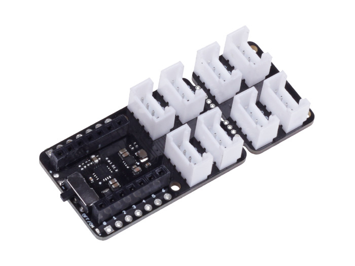

.. image:: /images/seeed_grove.png
   :align: right

.. _grove_base_shield_xiao_v1:

Grove Base Shield for XIAO V1
#############################

Overview
********

**Model:** 103020312

The `Grove Base Shield for XIAO V1`_ board provides a simple way to connect
with XIAO boards. This version 1 is the first member in the Grove System to
support low-cost, high-performance XIAO boards.

Pinout Diagram
==============

The pinout of Base Shield V2 is the same as `Seeeduino XIAO`_. The shield
usually has the same pin position as the Seeed Studio XIAO development board
and will be used as an carrier board.

Hardware
========

- `Grove Base Shield for XIAO V1.0 Eagle Files`_

+-------+-----------------------------------+----+----+----+-------+------+----+----+
| Name  | Function to Grove port-pin -->    | D0 | D1 | D2 |  I2C  | UART | D8 | D9 |
+=======+===================================+====+====+====+=======+======+====+====+
| D0    | Digital 0 / Analog 0              |  1 |    |    |       |      |    |    |
+-------+-----------------------------------+----+----+----+-------+------+----+----+
| D1    | Digital 1 / Analog 1 / SPI-CS (*) |  2 |  1 |    |       |      |    |    |
+-------+-----------------------------------+----+----+----+-------+------+----+----+
| D2    | Digital 2 / Analog 2              |    |  2 |  1 |       |      |    |    |
+-------+-----------------------------------+----+----+----+-------+------+----+----+
| D3    | Digital 3 / Analog 3              |    |    |  2 |       |      |    |    |
+-------+-----------------------------------+----+----+----+-------+------+----+----+
| D4    | Digital 4 / Analog 4 / I2C-SDA    |    |    |    |   2   |      |    |    |
+-------+-----------------------------------+----+----+----+-------+------+----+----+
| D5    | Digital 5 / Analog 5 / I2C-SCL    |    |    |    |   1   |      |    |    |
+-------+-----------------------------------+----+----+----+-------+------+----+----+
| D6    | Digital 6 / Analog 6 / UART-TX    |    |    |    |       |   2  |    |    |
+-------+-----------------------------------+----+----+----+-------+------+----+----+
| D7    | Digital 7 / Analog 7 / UART-RX    |    |    |    |       |   1  |    |    |
+-------+-----------------------------------+----+----+----+-------+------+----+----+
| D8    | Digital 8 / Analog 8 / SPI-CLK    |    |    |    |       |      |  1 |    |
+-------+-----------------------------------+----+----+----+-------+------+----+----+
| D9    | Digital 9 / Analog 9 / SPI-MISO   |    |    |    |       |      |  2 |  1 |
+-------+-----------------------------------+----+----+----+-------+------+----+----+
| D10   | Digital 10 / Analog 10 / SPI-MOSI |    |    |    |       |      |    |  2 |
+-------+-----------------------------------+----+----+----+-------+------+----+----+

(*) SPI bus also connected to the SPI-Flash bonding pads.

References
**********

.. target-notes::
