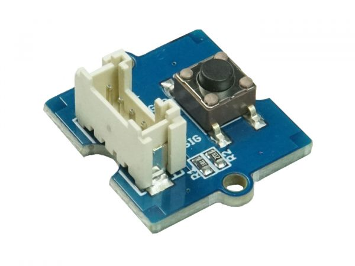

.. image:: /images/seeed_grove.png
   :align: right

.. _grove_button_v1:

Grove Button V1.2 and V1.0
##########################

Overview
********

**Model:** 101020003, 111020000

The `Grove Button V1.2`_ or `Grove Button V1.0`_ is a momentary push button
module in Grove form factor. With V1.2 an additional series resistance in the
signal line was added and also the pull down resistance was reduced.

Pinout Diagram
==============

The pinout of Grove Button following the `Grove Digital Layout`_.

+-----+----------+----------------+--------+--------+
| Pin | Function | Meaning        | Shield | Board  |
+=====+==========+================+========+========+
|  1  | Dn       | Digital Signal | Output | Input  |
+-----+----------+----------------+--------+--------+
|  2  | –        |                |        |        |
+-----+----------+----------------+--------+--------+
|  3  | VCC      | 3.3V or 5V     | Input  | Output |
+-----+----------+----------------+--------+--------+
|  4  | GND      | Ground         |        |        |
+-----+----------+----------------+--------+--------+

Hardware
========

The button outputs a HIGH signal when pressed, and LOW when released.

- `Grove Button V1.2 OHSW Lab Project`_
- `Grove Button V1.0 Eagle Files, Schematic and Layout`_

References
**********

.. target-notes::
