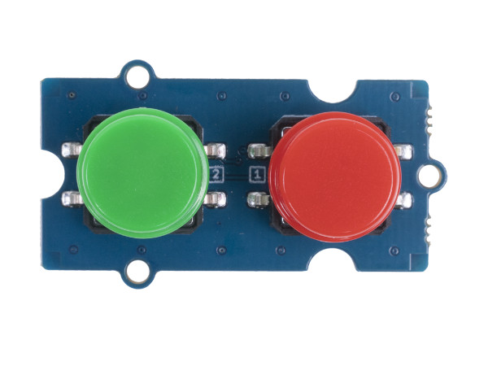

.. image:: /images/seeed_grove.png
   :align: right

.. _grove_dual_button_v1:

Grove Dual Button V1.0
######################

Overview
********

**Model:** 111020103 (r/g/b/w)

The `Grove Dual Button V1.0`_ includes 2 buttons, controls two signal channel
with one module. Both buttons are low active and drives high in dormant state
by an pull up resistance.

Pinout Diagram
==============

The pinout of Grove Button following the `Grove Digital Layout`_.

+-----+----------+----------------+--------+--------+
| Pin | Function | Meaning        | Shield | Board  |
+=====+==========+================+========+========+
|  1  | Dn       | Digital Signal | Output | Input  |
+-----+----------+----------------+--------+--------+
|  2  | Dn+1     | Digital Signal | Output | Input  |
+-----+----------+----------------+--------+--------+
|  3  | VCC      | 3.3V or 5V     | Input  | Output |
+-----+----------+----------------+--------+--------+
|  4  | GND      | Ground         |        |        |
+-----+----------+----------------+--------+--------+

Hardware
========

The button outputs (Dn or Dn+1) a LOW signal when pressed,
and HIGH when released.

- `Grove Dual Button V1.0 Eagle Files, Schematic and Layout`_
- `Grove Dual Button V1.0 Schematic`_

References
**********

.. target-notes::
