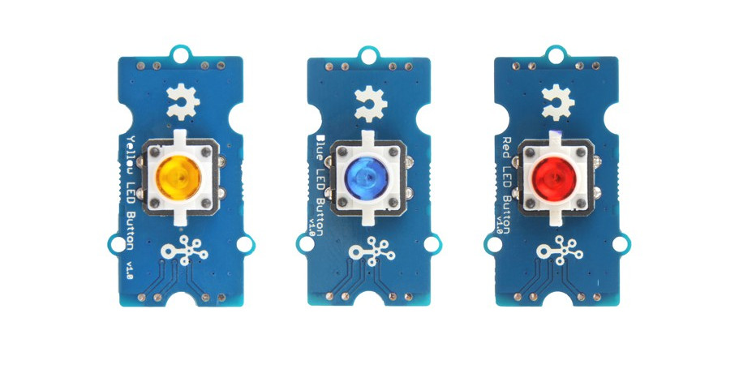

.. image:: /images/seeed_grove.png
   :align: right

.. _grove_led_button_v1:

Grove LED Button V1.0
#####################

Overview
********

**Model:** 111020044 (r), 111020045 (y), 111020046 (b)

The `Grove LED Button V1.0`_ is a combined module of either yellow, blue
or red LED with a momentary and tactile push button in Grove form factor.
It uses a N-Channel MOSFET to control the LED to ensure the high switching
speed and a low current consumption. The button is low active and drives
high in dormant state by an pull up resistance.

Pinout Diagram
==============

The pinout of Grove Button following the `Grove Digital Layout`_.

+-----+----------+----------------+--------+--------+
| Pin | Function | Meaning        | Shield | Board  |
+=====+==========+================+========+========+
|  1  | Dn       | Digital Signal | Input  | Output |
+-----+----------+----------------+--------+--------+
|  2  | Dn+1     | Digital Signal | Output | Input  |
+-----+----------+----------------+--------+--------+
|  3  | VCC      | 3.3V or 5V     | Input  | Output |
+-----+----------+----------------+--------+--------+
|  4  | GND      | Ground         |        |        |
+-----+----------+----------------+--------+--------+

Hardware
========

When input pin (Dn) is logic HIGH, the LED will light up.

- `Grove LED Button V1.0 Eagle Files, Schematic and Layout`_

References
**********

.. target-notes::
