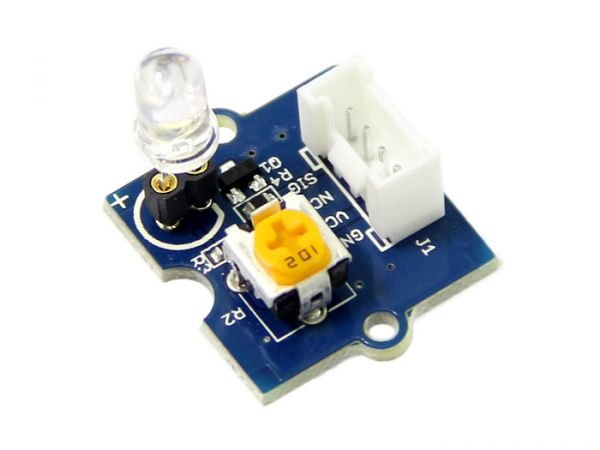

.. image:: /images/seeed_grove.png
   :align: right

.. _grove_led_socket_kit_v1:

Grove LED Socket Kit V1.3 and V1.0
##################################

Overview
********

**Model:** 104030005 (r), 104030007 (g), 104030010 (b), 104030009 (w)

The `Grove LED Socket Kit V1.3`_ or `Grove LED Socket Kit V1.0`_ is the more
complex general-purpose LED module in Grove form factor, available in different
colors with adjustable LED brightness and orientation. With V1.3 the LED will
active driven by a bi-polar NPN transistor.

Pinout Diagram
==============

The pinout of Grove LED Socket Kit following the `Grove Digital Layout`_.

+-----+----------+----------------+--------+--------+
| Pin | Function | Meaning        | Shield | Board  |
+=====+==========+================+========+========+
|  1  | Dn       | Digital Signal | Input  | Output |
+-----+----------+----------------+--------+--------+
|  2  | –        |                |        |        |
+-----+----------+----------------+--------+--------+
|  3  | VCC      | 3.3V or 5V     | Input  | Output |
+-----+----------+----------------+--------+--------+
|  4  | GND      | Ground         |        |        |
+-----+----------+----------------+--------+--------+

Hardware
========

When input pin is logic HIGH, the LED will light up.

- `Grove LED Socket Kit V1.3 Eagle Files and Schematic`_
- `Grove LED Socket Kit V1.0 Eagle Files`_

References
**********

.. target-notes::
