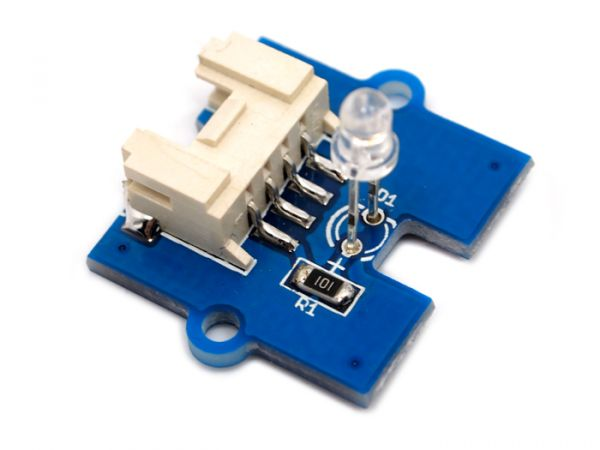

.. image:: /images/seeed_grove.png
   :align: right

.. _grove_purple_led_v1:

Grove (Purple) LED V1.1
#######################

Overview
********

**Model:** 104020002

The `Grove LED`_ is the simplest standard LED module in Grove form factor with
adjustable LED orientation. In V1.1 the LED size is 3mm and was 5mm in V1.0.

Pinout Diagram
==============

The pinout of Grove LED following the `Grove Digital Layout`_.

+-----+----------+----------------+--------+--------+
| Pin | Function | Meaning        | Shield | Board  |
+=====+==========+================+========+========+
|  1  | Dn       | Digital Signal | Input  | Output |
+-----+----------+----------------+--------+--------+
|  2  | –        |                |        |        |
+-----+----------+----------------+--------+--------+
|  3  | VCC      | 3.3V or 5V     | Input  | Output |
+-----+----------+----------------+--------+--------+
|  4  | GND      | Ground         |        |        |
+-----+----------+----------------+--------+--------+

Hardware
========

When input pin is logic HIGH, the LED will light up.

- `Grove LED V1.0 Eagle Files, Schematic and Layout`_

References
**********

.. target-notes::
