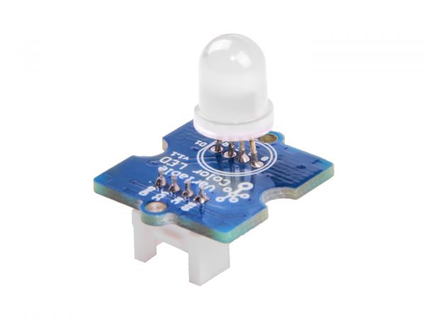

.. image:: /images/seeed_grove.png
   :align: right

.. _grove_variable_color_led_v1:

Grove Variable Color LED V1.1 and V1.0
######################################

**Model:** 101020472, 104020001

The `Grove Variable Color LED V1.1`_ or `Grove Variable Color LED V1.0`_ is an
RGB LED module in Grove form factor, the LED size is 8mm. It operates at 5V DC
only. The three resistances RED, GREEN and BLUE on the module control the R, G
and B channels respectively. By adjusting the three adjustable resistances, it
can turn out the variable color. With V1.1 a logic IC was add to avoid power
supply issues.

Pinout Diagram
==============

The pinout of Grove Variable Color LED following the `Grove Digital Layout`_.

+-----+----------+----------------+--------+--------+
| Pin | Function | Meaning        | Shield | Board  |
+=====+==========+================+========+========+
|  1  | Dn       | Digital Signal | Input  | Output |
+-----+----------+----------------+--------+--------+
|  2  | –        |                |        |        |
+-----+----------+----------------+--------+--------+
|  3  | VCC      | 5V             | Input  | Output |
+-----+----------+----------------+--------+--------+
|  4  | GND      | Ground         |        |        |
+-----+----------+----------------+--------+--------+

Hardware
========

When input pin is logic HIGH, the RGB LED will light up.

- `Grove Variable Color LED V1.1 Eagle Files and Schematic`_
- `Grove Variable Color LED V1.0 Eagle Files`_

References
**********

.. target-notes::
