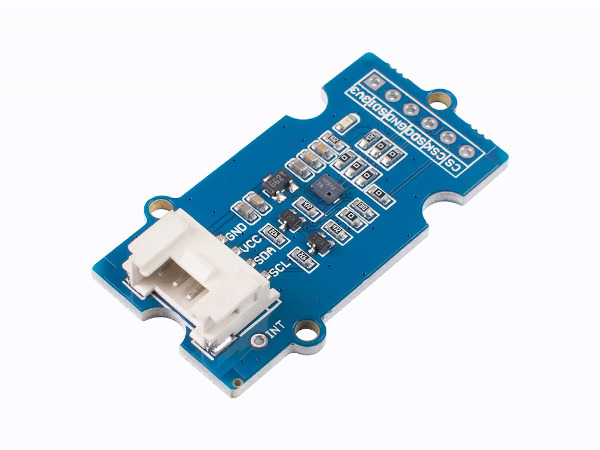

.. image:: /images/seeed_grove.png
   :align: right

.. _grove_sens_dps310_v1:

Grove High Precision Environmental Sensor V1.0 (DPS310)
#######################################################

Overview
********

**Model:** 101020812

The |Grove DPS310 Sensor|_ is a breakout module for Infineon DPS310_,
a miniaturized digital barometer air pressure and temperature sensor
with high accuracy, in Grove form factor.

Pinout Diagram
==============

The pinout of Grove Button following the `Grove I2C Layout`_.

+-----+----------+------------------+--------+--------+
| Pin | Function | Meaning          | Shield | Board  |
+=====+==========+==================+========+========+
|  1  | SCL      | I2C Serial Clock | Input  | Output |
+-----+----------+------------------+--------+--------+
|  2  | SDA      | I2C Serial Data  | IN/OUT | OUT/IN |
+-----+----------+------------------+--------+--------+
|  3  | VCC      | 3.3V or 5V       | Input  | Output |
+-----+----------+------------------+--------+--------+
|  4  | GND      | Ground           |        |        |
+-----+----------+------------------+--------+--------+

Hardware
========

- `Grove DPS310 Sensor V1.0 Eagle Files, Schematic and Layout`_

References
**********

.. target-notes::
